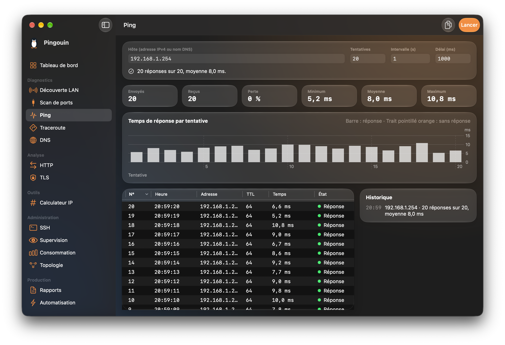
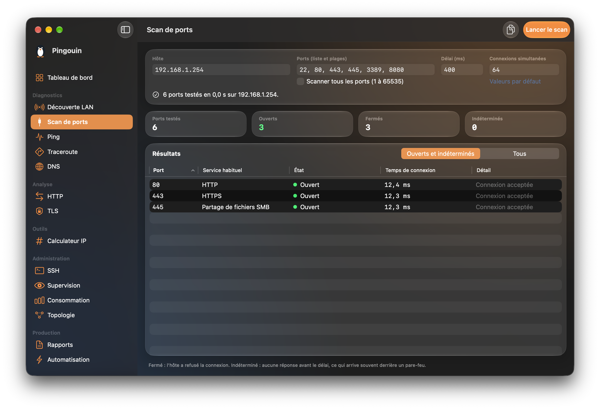
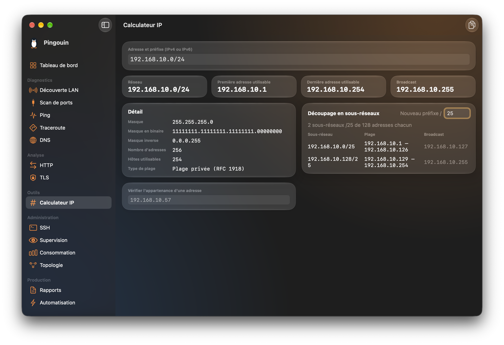
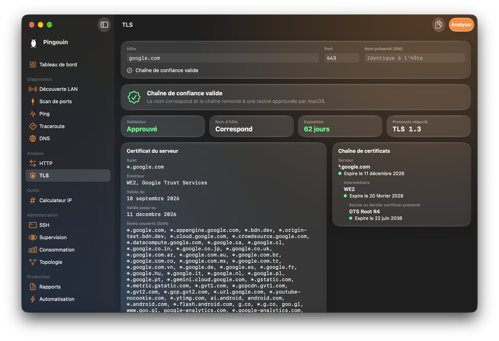
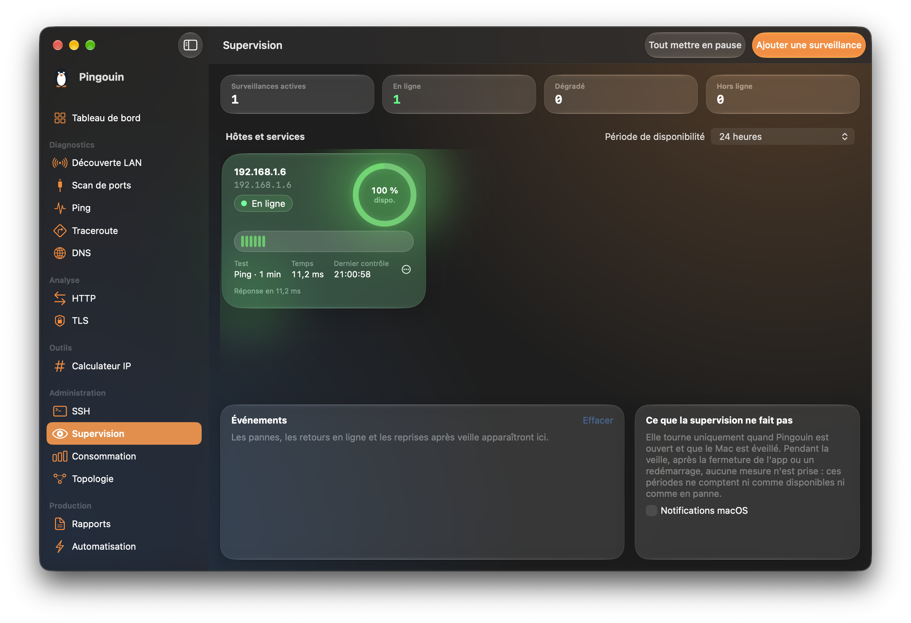

<p align="center">
  
</p>

# Pingouin

Boîte à outils réseau native pour macOS, iOS et iPadOS, pour les administrateurs réseau et les
techniciens : diagnostic, supervision locale, SSH et consommation par appareil, dans une seule
application.

- macOS 26 ou plus récent (interface Liquid Glass), Apple Silicon
- iOS 26 et iPadOS 26 ou plus récents
- Swift 6, SwiftUI
- Français, anglais, espagnol, allemand et italien
- Aucune télémétrie, aucun compte, aucun service en ligne : tout reste sur l'appareil

> **État du projet : en développement, pas de version publiée.**
> La version Mac est utilisable. La version iOS vient d'être écrite : elle compile, mais ses
> écrans n'ont pas encore tous été essayés sur un appareil.

## Aperçu

**Ping**
<p align="center">
  
</p>

**Scan de ports**
<p align="center">
  
</p>

**Calculateur IP**
<p align="center">
  
</p>

**Vérification TLS**
<p align="center">
  
</p>

**Supervision**
<p align="center">
  
</p>

## Outils

| Outil | Ce qu'il fait | macOS | iOS |
| --- | --- | --- | --- |
| Tableau de bord | Raccordement de l'appareil, test de connexion en quatre maillons, premiers pas | Validé | À essayer |
| Découverte LAN | Balayage ping, noms d'hôtes ; adresses MAC et IPv6 sur le Mac | Validé | À essayer, sans adresses MAC |
| Scan de ports | Ports TCP ouverts, fermés ou indéterminés | Validé | À essayer |
| Ping | Statistiques et graphique par tentative, IPv4 et IPv6 | Validé | Validé |
| Traceroute | Sauts, sondes, noms des équipements, IPv4 et IPv6 | Validé | À essayer |
| DNS | A, AAAA, CNAME, MX, TXT, NS, SOA, PTR, serveur au choix, comparaison | Validé | À essayer |
| HTTP | Code, redirections, décomposition du temps, en-têtes | Validé | À essayer |
| TLS | Confiance, expiration, chaîne de certificats | Validé | À essayer |
| Calculateur IP | Sous-réseaux IPv4 et IPv6, découpage | Validé | À essayer |
| SSH | Connexions enregistrées, terminal, thèmes | Validé | À essayer |
| SFTP | Parcourir, télécharger, envoyer, renommer, supprimer | Validé | À essayer, fichiers seulement |
| Supervision | Contrôles périodiques ping, TCP, HTTP, DNS ; disponibilité | Validé | À essayer, application à l'écran |
| Consommation | Volumes par appareil, relevés auprès de la Freebox | Validé | À essayer |
| Topologie | Schéma du réseau, nœuds et liens saisis ou constatés | Validé | À essayer |
| Rapports | Export PDF, CSV, JSON des résultats | Validé | À essayer |
| Automatisation | Tâches de contrôles, manuelles ou planifiées | Validé | À essayer, application à l'écran |

Un clic droit sur un hôte ou un port (un appui long sur iOS) lance directement un autre outil sur
cette cible.

### Ce qui diffère sur iOS

iOS ne laisse pas une application lancer des commandes ni travailler en arrière-plan :

- la découverte LAN ne trouve que les appareils qui répondent au ping, sans adresse MAC ;
- la supervision, les relevés de consommation et les tâches planifiées ne tournent que lorsque
  Pingouin est à l'écran ;
- SSH et SFTP passent par une bibliothèque (le Mac utilise les commandes `ssh` et `sftp` du
  système) : authentification par mot de passe ou par une clé Ed25519 créée sur l'appareil, et
  transfert de fichiers seulement, pas de dossiers entiers ;
- les exports passent par la feuille de partage.

## Compiler

Prérequis : Xcode 26 ou plus récent.

```sh
git clone https://github.com/a-mnt/pingouin.git
cd pingouin
open Pingouin.xcodeproj
```

Lancer le schéma **Pingouin** (Mac) ou **PingouinMobile** (iPhone et iPad). Dans les réglages de
signature de chaque cible, choisir sa propre équipe de développement.

Au premier lancement, Xcode télécharge les dépendances tierces :

- [SwiftTerm](https://github.com/migueldeicaza/SwiftTerm) : terminal intégré, sur les deux versions ;
- [Citadel](https://github.com/orlandos-nl/Citadel) : SSH et SFTP sur iOS seulement, avec
  SwiftNIO et SwiftNIO SSH dont elle dépend. Citadel utilise une copie de SwiftNIO SSH tenue par
  un tiers, et non le dépôt d'Apple (voir `docs/adr/0013-ssh-et-sftp-sur-ios.md`).

Tests de la logique pure, sans réseau ni Xcode ouvert :

```sh
swift test --package-path Packages/PingouinKit
```

## Ce que l'application fait sur le réseau

Pingouin n'envoie rien sans action explicite, sauf les contrôles périodiques que l'on a soi-même
enregistrés (supervision, automatisation, relevés de consommation). Les balayages étendus demandent
une confirmation. **Ne scanner que des équipements que l'on est autorisé à tester.**

Les secrets (mots de passe SSH, jeton de la box, clé SSH de l'appareil) sont dans le Trousseau,
jamais dans un fichier. En SSH sur iOS, la clé d'un serveur doit être acceptée à la première
connexion, et une clé qui change fait refuser la connexion.

## Organisation du code

- `App/`, `Features/` : l'application Mac, un dossier par outil
- `PingouinMobile/` : l'application iOS et iPadOS
- `Shared/` : ce que les deux applications ont en commun (modèles de présentation, réglages, stockage)
- `DesignSystem/` : composants d'interface Liquid Glass
- `Resources/` : catalogue de traductions et ressources graphiques
- `Packages/PingouinKit/` : `PingouinCore` (calculs purs, testés) et `PingouinNetwork` (services système)
- `Scripts/traductions.py` : vérifie que chaque texte de l'interface est traduit
- `docs/adr/` : décisions d'architecture

## Licence

GPL, version 3 : voir [LICENSE](LICENSE).
